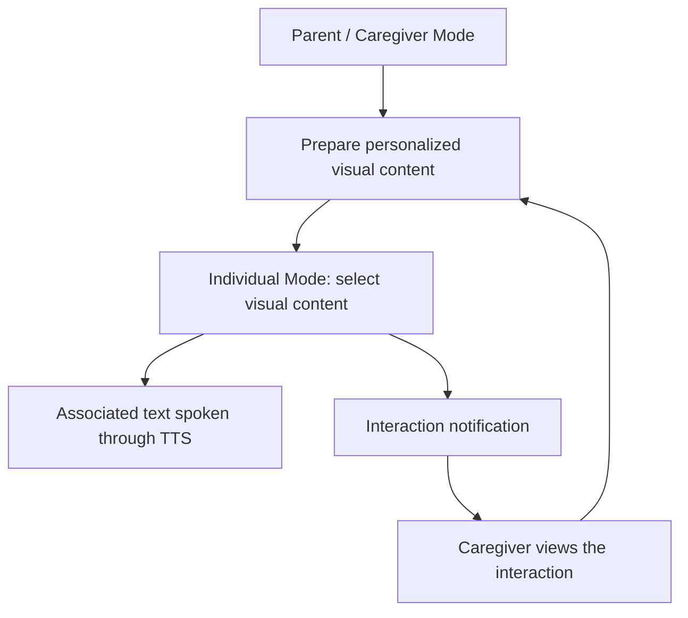

# Personalized Assistive Communication

Research participation portfolio for a collaborative mobile communication project at **Manisa Celal Bayar University**, accepted under **TÜBİTAK 2209-B**, 2024/1 application cycle.

**Status as of 31 October 2026:** accepted under the program; official project closure approval is pending, according to the project lead's update relayed by Devran Deniz Akgül. This status does not establish completed implementation or final approval of the research results.

**Repository type:** research documentation and personal role record. **My role:** project participant with proposal-assigned testing and feedback responsibilities. I did not write application source code.

## Project Overview

The project aims to help people with special communication needs express everyday needs, choices and feelings through familiar visual content and speech output. It proposes a customizable mobile experience for individuals and their parents or caregivers, with particular attention to children who need communication support.

The original project title is *Özel Gereksinimli Bireyler İçin Kişiselleştirilebilir Mobil İletişim Uygulaması* (Personalizable Mobile Communication Application for Individuals with Special Needs).

## Research Objectives

- Support everyday communication through recognizable visual content and associated spoken text.
- Allow caregivers to adapt content to an individual's interests, familiar people and surroundings.
- Explore simple, accessible interfaces for Individual Mode and Parent/Caregiver Mode, including Turkish-language needs.
- Use functional testing, usability evaluation and user feedback to guide improvements.

These are research objectives from the proposal. This repository reports no measured communication gains, clinical outcomes or usability scores.

## Proposed Technologies

The table describes the **proposed technical approach**, not a verified inventory of the delivered application or a list of technologies I personally implemented.

| Technology or approach | Intended purpose | Evidence and qualification |
| --- | --- | --- |
| Flutter | Mobile application targeting Android and iOS | Explicitly proposed; implementation and platform coverage are unverified here |
| Dart | Language associated with the proposed Flutter approach | Technical inference from Flutter; not separately named in the proposal |
| Firebase | Caregiver notifications and cloud-supported data processes | Named in the proposal; individual Firebase products and configuration are not established |
| Google Cloud | Data storage and management infrastructure | Named at platform level; deployed services are unverified |
| Text-to-Speech (TTS) | Spoken output associated with visual content | Proposed capability; no engine or package is specified |
| Digital PECS-inspired interaction | Visual card selection and arrangement for communication | Proposed interaction approach, not a software library or a claim of certified PECS implementation |

The [Flutter documentation](https://docs.flutter.dev/resources/faq#what-language-is-flutter-written-in) provides the basis for the Dart inference. TTS refers to speaking text associated with content; image recognition is not established by the proposal.

## Project Scope and Methodology

**Individual Mode** would provide a simple way to interact with familiar pictures and visual cards, with associated speech output. **Parent/Caregiver Mode** would support uploading and managing personalized content and receiving notifications about content interactions.

The proposal describes a 12-month sequence of application development, functional testing, interface refinement, advanced features and final user testing. The relative months are planning intervals, not verified calendar dates or completion records.

This original diagram summarizes the **planned user flow**. It does not represent a verified implementation or deployed system architecture.

Read the [methodology and proposal timeline](docs/methodology.md) and the [illustrative testing approach](docs/testing-approach.md) for further detail.

## My Role and Responsibilities

**Devran Deniz Akgül - project participant; assigned testing and feedback responsibilities.**

Page 6 of the proposal assigns me the following work:

| Work package | Assigned scope | Planned period |
| --- | --- | --- |
| WP2: Testing and issue resolution | Functional testing and evaluation of user feedback within the testing and issue-resolution process | Months 5-7 |
| WP4: Advanced features | Shared assignment with Ferhat Baydır for the work package covering notifications and personalized content upload | Months 10-11 |
| WP5: Final testing and refinement | Shared assignment with Eren Malkoç and Ferhat Baydır for end-user testing and final adjustments | Month 12 |

**I did not write source code for this project.** The work-package assignments do not establish that I implemented modules, fixed code or completed every planned test. Specific executed activities and outcomes are not yet substantiated in this portfolio. See the [role record and evidence boundaries](docs/my-contributions.md).

## Team and Academic Context

This was a collaborative undergraduate research project within the TÜBİTAK 2209-B industry-oriented undergraduate research support program at Manisa Celal Bayar University.

| Team member | Role and proposal-assigned work |
| --- | --- |
| Eren Malkoç | Project lead; application development and TTS with Ferhat; interface refinement; final testing with the team |
| Ferhat Baydır | Team member; application development and TTS with Eren; advanced features with Devran; final testing with the team |
| Devran Deniz Akgül | Team member; functional testing and feedback evaluation; shared advanced-feature and final-testing work packages |

These are proposal assignments, not a verified record of completed development by individual team members. The proposal also identifies academic and industry supervision.

## Project Status

- **Accepted under TÜBİTAK 2209-B**, 2024/1 application cycle, as confirmed by the repository owner.
- **Official closure approval pending as of 31 October 2026**, based on the project lead's update.
- Final implementation scope, executed test results and research outcomes are not verified by the materials published here.

The project lead has clarified that **GoKid is a separate product developed for an association outside this TÜBİTAK project**. It is not presented here as a project deliverable or as my software development work.

## Source Code Availability

This is a personal research participation portfolio. Application source code is not included, and the repository owner does not hold a source-code copy for publication. There are no installation instructions or runnable application releases.

The project lead has permitted a portfolio description of the project and my role within the proposal's scope. This repository contains original summaries and an original conceptual diagram. It excludes the original research proposal PDF, third-party diagrams and assets, private technical details, and real user data.

## Documentation

| File | Purpose |
| --- | --- |
| [Methodology](docs/methodology.md) | Proposed scope, work packages, risks and expected outputs |
| [My contributions](docs/my-contributions.md) | Documented assignments, confirmed role limits and source basis |
| [Testing approach](docs/testing-approach.md) | Illustrative scenarios prepared for this portfolio; no execution results |

Prepared on 31 October 2026 from the 2024/1 proposal and the repository owner's subsequent clarifications. The original application and approval records are not reproduced here.
